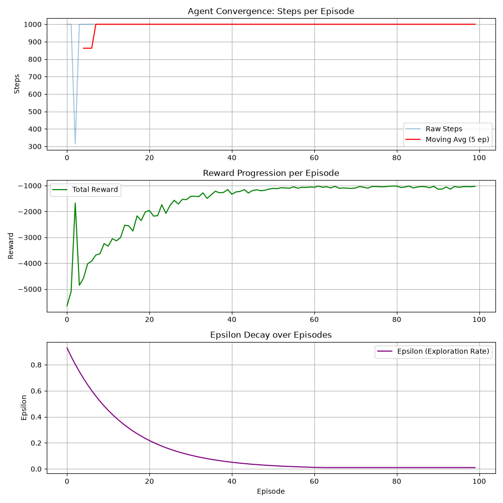

# GridWorld RL

A reinforcement learning project that combines a C++ GridWorld environment with Python-based Q-learning.

The environment, procedural maze generation, and A* pathfinding are implemented in C++, then exposed to Python using pybind11. Python is used for reinforcement learning, experimentation, evaluation, and visualization.

## Features

- C++ GridWorld environment
- Procedural maze generation
- A* pathfinding
- Q-learning agent
- Python Gym-style environment wrapper
- C++ ↔ Python bindings using pybind11
- CMake build system
- Training and performance visualization
- Support for comparing learned policies against A*

## Architecture

The project separates environment logic from reinforcement learning:

```text
C++
├── GridWorld
├── Maze Generator
├── A* Pathfinding
└── pybind11 bindings
        ↓
Python
├── Gym-style environment wrapper
├── Q-learning agent
├── Training / evaluation
└── Visualization
```

This allows the performance-sensitive environment and pathfinding logic to remain in C++, while Python is used for rapid reinforcement-learning experimentation.

## Project Structure

```text
GridWorld-RL/
├── AStar.cpp
├── AStar.hpp
├── GridWorld.cpp
├── GridWorld.hpp
├── MazeGenerator.cpp
├── MazeGenerator.hpp
├── Types.hpp
├── bindings.cpp
├── CMakeLists.txt
│
├── python/
│   ├── agent.py
│   ├── gridworld_gym_env.py
│   ├── main.py
│   └── visualization.py
│
└── results/
    └── gridworld_performance.png
```

## C++ / Python Integration

The C++ environment is exposed to Python through pybind11.

CMake builds the core environment as a reusable C++ library and links it into a Python extension module.

This allows Python code to create and interact with the same GridWorld implementation without rewriting the environment logic in Python.

## Reinforcement Learning

The Python side implements a Q-learning agent that learns a policy through interaction with procedurally generated GridWorld environments.

The agent uses an epsilon-greedy policy to balance:

- exploration of unfamiliar actions
- exploitation of actions with high learned Q-values

Training can be evaluated using metrics such as:

- episode reward
- episode length
- success rate
- training time
- path length

## A* Comparison

A* is implemented as a deterministic pathfinding baseline.

The project uses A* as a reference for comparing the learned Q-learning policy against an optimal graph-search approach.

Useful comparisons include:

- path length
- success rate
- optimality gap
- training cost versus direct search

## Results

Current training visualization:



More quantitative comparisons between Q-learning and A* will be added as the experiment framework is expanded.

## Building

### Requirements

- C++23 compiler
- CMake
- Python 3
- pybind11

### Linux / WSL

Configure the project:

```bash
cmake -S . -B build
```

Build:

```bash
cmake --build build
```

The resulting pybind11 module can then be imported from Python.

## Development

The project has been developed and tested using:

- C++23
- Python
- CMake
- pybind11
- Linux / WSL
- gdb
- Git

## What I Learned

This project has been used to develop practical experience with:

- reinforcement learning fundamentals
- Q-learning and epsilon-greedy exploration
- procedural environment generation
- A* pathfinding
- C++ / Python interoperability
- CMake target-based builds
- static libraries and shared Python modules
- Linux development workflows
- native C++ debugging with gdb
- experiment design and performance evaluation

## Future Improvements

- Add more structured experiment logging
- Track training time across configurations
- Compare different reward functions
- Add additional Q-learning evaluation metrics
- Improve A* versus Q-learning benchmarking
- Save experiment results to CSV/JSON
- Add more visualizations
- Expand automated testing
